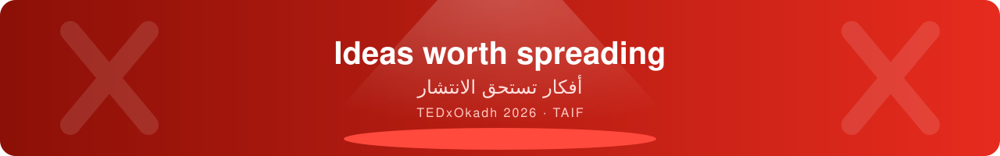

### 🎤 Two days of ideas worth spreading, in Taif, Saudi Arabia

---

## 👩‍💻 My Role — Lamar Bader Altalhi
**Volunteer Web Designer / Developer** · 04/2026 – 05/2026 · Taif

<table>
<tr>
<td width="50%" valign="top">

### 🎨 Design & Development
- **Designed and developed** the TEDxOkadh website as part of the volunteer team.
- Helped bring the event's identity to the web with TEDx's red-and-black style.

</td>
<td width="50%" valign="top">

### ✨ User Experience
- **Collaborated with the team** to improve the website's user experience and interface.
- Focused on making event information clear and easy to reach for every visitor.

</td>
</tr>
</table>

---

## 🎟️ The Event

| 📍 City | 🗓️ Edition | ⏱️ Length | 🗣️ Languages |
|:--:|:--:|:--:|:--:|
| **Taif** | **3rd · 2026** | **2 days of talks** | **Arabic · English** |

---

## 🌐 What the Website Offers

| | Feature | Description |
|:--:|:---|:---|
| 🌍 | **Bilingual site** | Full Arabic and English versions. |
| ⏳ | **Countdown** | A live countdown to the event day. |
| 🎫 | **Ticket booking** | Visitors reserve their seats online. |
| 📅 | **Agenda** | Speakers and talks for both days. |
| ✅ | **Door check-in** | Tickets are scanned and verified at the entrance. |

---

Built with ❤️ by the TEDxOkadh volunteer team. This repository showcases my contribution to the website.

<i>This independent TEDx event is operated under license from TED.</i>

